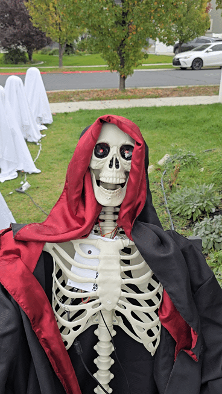

# Talking Skeleton

A Halloween porch skeleton that notices trick-or-treaters and has a short spoken
conversation with them in a spooky voice. Its jaw and eyes move along with the voice.
(It can also try to look at their costumes, but that part didn't work well; see below.)

<p align="center"></p>

**[Demo video on YouTube](https://youtu.be/BNor4MIeyNo)**: the skeleton on the porch.

When someone walks up:

1. A **mmWave radar** in the skeleton's box notices them.
2. The skeleton plays a pre-generated **greeting**.
3. *Optional, off by default (`VISION_ENABLED`):* during the greeting its **camera** takes 3
   photos, and a Gemini vision model describes the **costumes** ("a small kid in a dinosaur
   suit, a parent dressed as a witch") so the skeleton can talk about them. In practice this
   never worked on the night; see [Lessons from Halloween night](#lessons-from-halloween-night).
4. A **Gemini Live** voice conversation starts. Replies are one or two sentences, pitched down
   with reverb, and played on the speaker. The **jaw servo** (and an optional mouth LED)
   follow the loudness of the voice.
5. After a few turns, a long silence, a time limit, or once the visitor walks away, it says
   goodbye. A short cooldown follows.

It has two personalities. **Family** (goofy, punny) runs early in the evening, and **scary**
(slow, ominous, never gory) takes over later. Scary mode drops the act if a visitor sounds
young or frightened.

## Features

- **Gemini Live conversation** with hard safety rules (`skeleton/prompts.py`), plus optional
  costume-aware context from the camera.
- **Two personas** that switch on a clock (`SCARY_START` / `SCARY_END`). You can override
  the persona from the admin UI or with `mode.txt`. Each persona can have its own voice and effects.
- **Low-latency voice FX**: a custom pitch shifter (~25 ms) plus pedalboard reverb and drive.
- **Phone-friendly admin UI** (port 8080) with:
  - live status and the server log
  - persona switch
  - voice, FX and timing settings
  - "say this out loud"
  - manual "someone arrived / left" buttons
  - motion-sensor on/off
  - last camera frames, plus a test-photo button
  - jaw calibration and LED brightness, saved to the board's flash
  - random spooky phrases on a timer
  - looping background music that fades out when someone arrives
- **Two ESP32 boards**, both thin WebSocket clients:
  - a ReSpeaker Lite for audio
  - an ESP32-S3-CAM for the radar, camera, LEDs and servo
- **Device auth**: the boards send a bearer token. They connect over `wss://` through a
  reverse proxy such as Traefik, or over plain `ws://` on your LAN.
- **`aux` presence listeners**: let other gadgets (a fog machine, porch lights) react when
  visitors come and go ([`PROTOCOL.md`](PROTOCOL.md)).
- **No hardware needed to try it.** A Mac simulator uses your mic, speakers and webcam.
  **Echo mode** runs without an API key.

## How it fits together

```
 ┌─────────── skeleton box ────────────┐
 │ ESP32-S3-CAM  "body"                │          ┌──────────── server (Python / Docker) ────────────┐
 │  radar, camera, eyes, mouth, jaw    │◄──ws/wss─┤ skeleton.server                                  │
 │                                     │          │  :8765 device WebSocket (Bearer token)           │──► Gemini Live (voice)
 │ ReSpeaker Lite  "audio"             │◄──ws/wss─┤  :8080 admin UI (no login; protect it!)          │──► Gemini Flash (costumes)
 │  mic up, speaker down               │          │  greetings, persona, FX, mouth envelope, music   │
 └─────────────────────────────────────┘          └──────────────────────────────────────────────────┘
```

The server does all the work. The boards only stream audio, report presence, take photos
when asked, and apply the mouth level they're sent. The wire format is in
[`PROTOCOL.md`](PROTOCOL.md).

## Quick start (no hardware)

You need Python 3.11+. The simulator needs a Mac or another machine with a mic, speakers and,
optionally, a webcam. `setup.sh` is written for macOS but works on Linux too. On
Debian/Ubuntu, `pedalboard` also needs `sudo apt install libatomic1`, and the simulator needs
PortAudio (`libportaudio2`).

```bash
./setup.sh                      # makes .venv, installs requirements.txt, creates .env
source .venv/bin/activate
python -m skeleton.server                   # terminal 1
python -m skeleton.sim_client --mouth       # terminal 2: Enter = visitor arrives, l = leaves, q = quit
```

Without a `GEMINI_API_KEY` in `.env`, the server runs in **echo mode**. The skeleton parrots
your voice back through the effects, which is enough to test audio, FX and the mouth meter.

For the real thing, get a key at <https://aistudio.google.com/apikey> and put it in `.env`.
On the first start the server generates the greeting clips in the skeleton's voice (about
20 s). Open the admin UI at <http://localhost:8080>.

The first time it runs, macOS asks to give your terminal access to the microphone and camera.
Allow both, then restart the client. Use `--no-camera` to skip the webcam, and `--list-devices`
plus `--input-device N --output-device M` to pick audio devices.

## Build the real thing

| Step | Doc |
|---|---|
| Parts, wiring, power, enclosure | [`docs/HARDWARE.md`](docs/HARDWARE.md), [`hardware/`](hardware/) |
| Flash the two boards | [`docs/FIRMWARE.md`](docs/FIRMWARE.md) |
| Run the server (Docker), `.env` reference, **Traefik / wss** | [`docs/DEPLOY.md`](docs/DEPLOY.md) |
| Voice, effects, personas, greetings, jaw/LED calibration | [`docs/TUNING.md`](docs/TUNING.md) |
| Admin HTTP API | [`docs/ADMIN_API.md`](docs/ADMIN_API.md) |
| Device ↔ server protocol | [`PROTOCOL.md`](PROTOCOL.md) |

You can do this in stages. The ReSpeaker can be the `audio` device while the Mac simulator
plays the `body` (`python -m skeleton.sim_client --role body --mouth`). Enter acts as the
radar and the webcam acts as the camera.

## Lessons from Halloween night

This was built as a one-off for a single Halloween night, and the code shows it in places.
What happened on the night:

- **The radar worked perfectly in testing, but had mixed results on the night.** So many kids
  were walking through at once that "someone arrived / left" got unreliable.
- **Two admin UI switches saved the night.** *Motion sensor off* stops the skeleton greeting
  you while you're working on the porch. *Random phrases* says a spooky line every 30 s
  whatever the radar thinks. Together they kept the decoration effective even when the
  radar wasn't.
- **The costume detection didn't work a single time.** The ESP32's little camera, inside a box
  at skeleton height, with porch lighting, wasn't good enough. Next time I'd use a separately
  mounted camera (e.g. an existing doorbell or security camera) instead. Because of that,
  costume detection is **off by default** (`VISION_ENABLED=false`); turn it on to experiment.
- **Hiding the hardware:** the skeleton sat in a chair wearing a robe, which covered the
  wires and the box.

## Costs and privacy

- **Gemini API usage costs money.** Each visitor uses one Live session (up to
  `MAX_CONVERSATION_S`, 90 s by default), plus one vision call if `VISION_ENABLED`. Check Google's current pricing
  and set a budget alert.
- **Visitors' voices and photos are sent to Google.** On the free tier, Google may use that
  content to improve its products. **Enable billing on the project before Halloween night.**
  Consider a small sign by the door.
- **Camera frames are not saved to disk by default.** They're held in memory for the vision
  call, and the admin UI shows the last 8. Set `PHOTOS_KEEP=N` to keep the newest N frames
  for debugging. They are photos of other people's children, so delete them afterwards.
- Transcripts of what visitors say appear in the server log (and the admin UI's log view).
  Nothing else is recorded.
- **The admin UI has no login.** On a LAN that's fine. On the internet, put authentication
  in front of it (see [`docs/DEPLOY.md`](docs/DEPLOY.md)).

## Tests (no mic, hardware or API key needed)

```bash
pip install -r requirements-server.txt      # or requirements.txt
python -m tests.smoke_test          # one fake "both" device vs. the server, echo mode
python -m tests.split_test          # fake audio + body devices: routing and mouth timing (timing-sensitive)
python -m tests.jaw_test            # jaw/LED admin API → body device round trip
python -m tests.test_fx             # pitch shifter / FX edge cases
python -m tests.test_modes          # persona mode switching
python -m tests.test_ambient        # background music loop, volume, fade-out
python -m tests.test_auth           # DEVICE_TOKEN check on the WebSocket upgrade
python -m tests.test_aux            # aux presence listeners, camera rotation
python -m tests.test_chatter        # random phrases
python -m tests.test_settings_store # admin UI settings overrides
python -m tests.test_photos         # camera frames only saved when PHOTOS_KEEP > 0
python -m tests.test_admin_origin   # admin API rejects cross-site browser POSTs
```

## Troubleshooting

- **Model not found / 404**: Google renames models often. Check
  <https://ai.google.dev/gemini-api/docs/models> and set `LIVE_MODEL` / `VISION_MODEL`.
- **Unknown voice error**: the `VOICE` name is wrong. Pick one from AI Studio's Live playground.
- **"device never confirmed playback"**: run the simulator with `--debug`. The conversation
  continues after a short fallback delay.
- **It answers itself**: raise `ECHO_GUARD_S` (e.g. 0.4) or use headphones with the simulator.
- **"vision too slow"**: raise `VISION_GRACE_S`. The greeting's length is most of the time
  budget for the vision call.
- **Boards get HTTP 401**: `SERVER_TOKEN` in the board's `config.h` doesn't match `DEVICE_TOKEN`.
- Board-specific problems: see the troubleshooting sections in
  [`firmware/body/README.md`](firmware/body/README.md) and
  [`firmware/audio/README.md`](firmware/audio/README.md).

## Layout

```
skeleton/server.py        WebSocket server + conversation state machine
skeleton/admin.py         admin UI + HTTP API (aiohttp), static/index.html
skeleton/brain.py         GeminiBrain (Live API) and EchoBrain (no-API test)
skeleton/vision.py        costume description (structured JSON)
skeleton/fx.py            low-latency pitch, pedalboard FX, 16 kHz resample, mouth envelope
skeleton/prompts.py       family + scary personas, shared safety rules, vision prompt, default lines
skeleton/modes.py         which persona is active (clock / mode.txt) and its voice/FX
skeleton/greetings.py     greeting generation (same voice) and loading
skeleton/chatter.py       random phrases
skeleton/ambient.py       idle background music (loop, volume, fade-out)
skeleton/settings_store.py admin UI overrides (settings.json)
skeleton/sim_client.py    simulated device (Mac mic/speaker/webcam)
skeleton/fx_preview.py    FX audition tool
firmware/                 body, audio and respeaker-test (PlatformIO)
hardware/                 enclosure and servo horn (OpenSCAD + STL)
docs/                     hardware, firmware, deployment, tuning, admin API
```

## License

[MIT](LICENSE). Built by Collin Winget.
